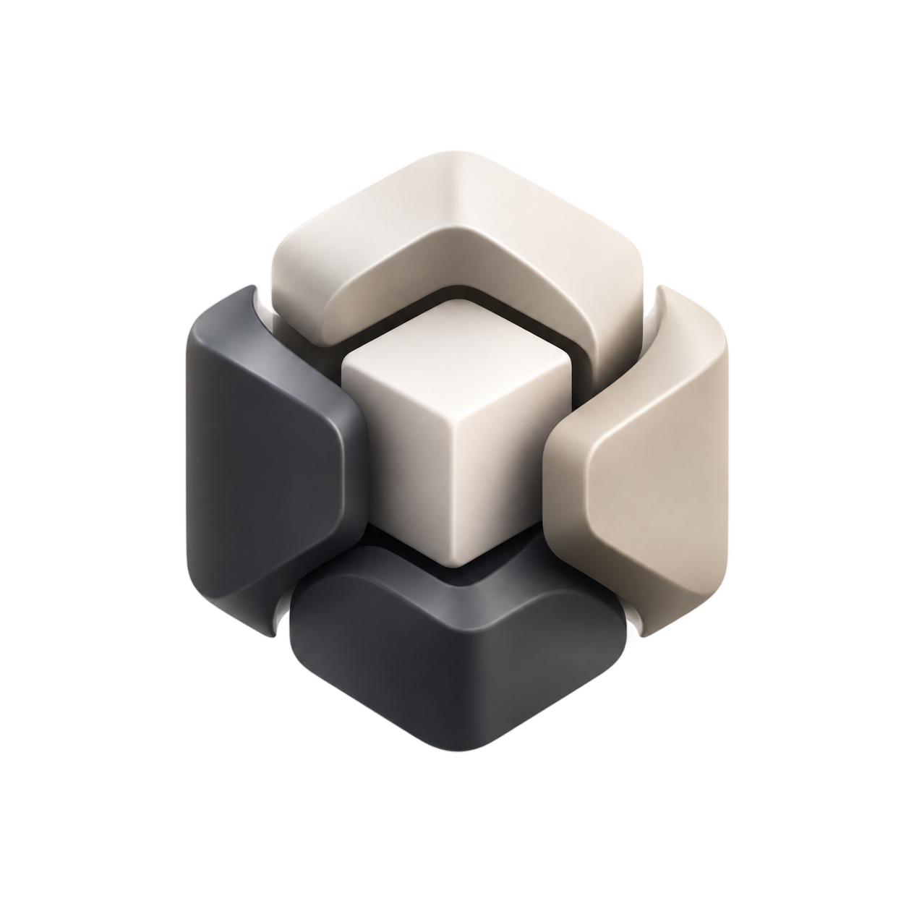

<div align="center">
  
  <p>
    <strong>Extract, unify, and diff UI component APIs across framework ports.</strong><br/>
    UCP scans a component library's source code, extracts its component APIs into a
    framework-agnostic <b>Canonical Abstract Model (CAM)</b>, merges specs from multiple
    ports, flags drift and conflicts, and exports to DESIGN.md, LLMs.txt, W3C mapping,
    DTCG tokens, and the shadcn registry. Written in Rust. Fully offline. No AI.
  </p>
  <p>
    
    
    
    
  </p>
</div>

---

# UCP

## The problem

Popular component libraries exist as parallel ports: shadcn/ui alone has React, Vue,
Svelte, Leptos, Dioxus, and Swift ports. When upstream ships a new prop, every port
must be updated by hand, and nothing tells you which port is missing what. Port APIs
drift silently.

## What UCP does about it

UCP is a deterministic, offline API-drift detector and spec unifier for multi-framework
component libraries:

| Stage | Command | What happens |
|-------|---------|--------------|
| **Bootstrap** | `ucp bootstrap` | Scans source files in parallel, extracts component definitions with a real tokenizer (TSX) and `syn` (Rust), and writes `ucp-spec.json`. |
| **Merge** | `ucp merge` | Combines specs from several ports into ONE unified component per name, uniting `onClick` with `on_click`, and flags presence drift (prop in port A, missing in port B) plus type conflicts. |
| **Validate** | `ucp validate` | Structural checks (duplicate ids, bad confidences, empty names); exits non-zero on blocking issues — CI-ready. |
| **Diff / Verify** | `ucp diff`, `ucp verify-spec` | Structural spec comparison and drift detection against the current source. |
| **Curate** | `ucp curate` | Ratatui TUI to resolve flagged conflicts interactively. |
| **Export** | `ucp export` / `ucp export-all` | DESIGN.md, LLMs.txt, W3C mapping, DTCG tokens, shadcn registry. |
| **Watch** | `ucp watch` | Rebuilds on change; the incremental parse cache makes re-runs proportional to what changed, not repo size. |
| **Generate** | `ucp generate` | Typed component stubs for React, Leptos, Dioxus, GPUI, and Web Components. |

## Quick start

```bash
cargo install ucp-cli

# Extract a spec from a source directory
ucp bootstrap --source-dir ./my-app/src --output-dir ./spec

# Merge specs from two ports into one canonical spec
ucp merge --input react-spec.json --input leptos-spec.json -o merged.json

# Check structural soundness (exit code 1 on blocking issues)
ucp validate --json merged.json

# Machine-readable output everywhere
ucp bootstrap --source-dir ./src --output-dir ./spec --json
```

## Why you can trust the output

- **Deterministic**: identical input produces byte-identical specs. Specs live in
  version control and diffs mean what they say.
- **Static analysis only**: no LLM calls, no network, no "AI enrichment". Extraction
  bugs are reproducible and testable.
- **Evidence attached**: every merged prop keeps its per-port source mappings, so a
  conflict statement points at the exact files that disagree.
- **Benchmarked**: criterion benches cover the tokenizer, the pipeline, and the merge
  path (`cargo bench -p ucp-synthesizer`).

## Workspace crates

| Crate | Purpose |
|-------|---------|
| `ucp-core` | CAM types, naming normalization, SMDL parser, structural validation, errors. |
| `ucp-synthesizer` | Extraction (Rust/TSX/Svelte/Vue/Dioxus), unification, merge, conflict engine, incremental cache, exports, generators, benches. |
| `ucp-maintainer` | Curation TUI, diff, drift detection, token merge, SQLite registry, watch mode. |
| `ucp-cli` | The `ucp` binary: subcommands, `--json` output, exit codes. |

## Documentation

- [Quickstart](docs/user/quickstart.md) — first spec in five minutes.
- [CAM concepts](docs/user/concepts/cam.md) — the framework-agnostic model.
- [Architecture](docs/maintainer/architecture.md) — crate responsibilities and data flow.
- [TRANSFORMATION.md](TRANSFORMATION.md) — what changed in 0.13.0 and why.
- [ROADMAP.md](ROADMAP.md) — concrete, boring, achievable next steps.

## Design principles

- **Determinism over magic.** Same input, same bytes. Always.
- **Evidence over inference.** Every claim in a spec traces to source lines.
- **Boring dependencies.** No network clients, no runtimes beyond tokio, no
  speculative format support.
- **CI-first DX.** `--json` everywhere, real exit codes, `validate` that validates.

## License

MIT — see [LICENSE](LICENSE).
